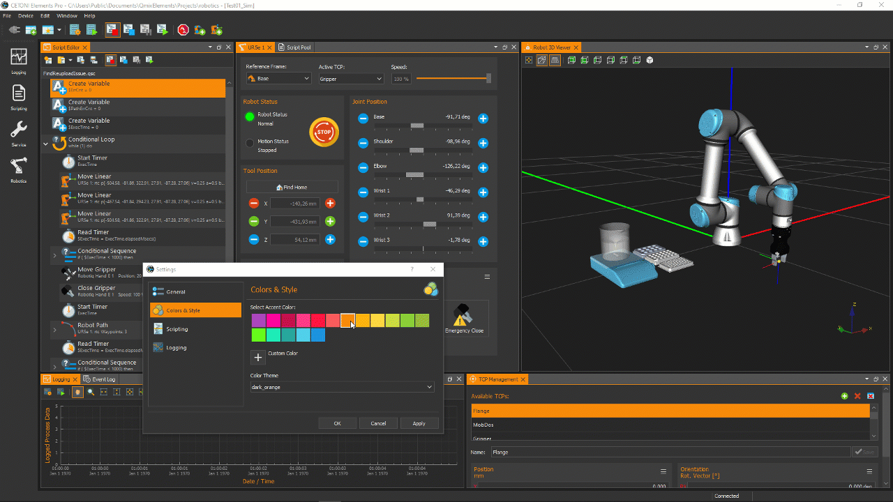

# qtass-pyside6

**Qt Advanced Stylesheets for PySide 6**

[](https://pypi.org/project/qtass-pyside6/)
[](https://www.python.org/downloads/)

This is the Python version of the [Qt Advanced Stylesheets Project](https://github.com/githubuser0xFFFF/Qt-Advanced-Stylesheets) for C++.

The library allows runtime color switching for CSS stylesheet themes including
SVG resources and SVG icons. The image below shows switching of accent color
and switching between dark and light theme. Notice how the icons in the left 
sidebar change color when switching between dark and light theme.



The main features are:

- runtime switching of CSS colors
- runtime color switching of CSS SVG icons / resources
- runtime color switching of icons loaded via `loadThemeAwareSvgIcon()`
- runtime switching of QPalette colors
- definition of CSS styles that switch the complete application design
- definition of XML color themes that allow switching of theme colors (dark / light)
- switching of individual theme color or switching of accent color
- QML support

---

## 📦 Installation

Install from **PyPI**:

```shell
pip install qtass-pyside6
```

## Accent color sources (1.0.0)

The existing `accentColor` variable now supports three sources. Theme selection
(Dark/Light) and accent selection are independent.

```python
from PySide6.QtGui import QColor
from qtass import AccentSource, QtAdvancedStylesheet

style = QtAdvancedStylesheet()  # construct before applying your own palette
style.set_current_style("metro")
style.set_current_theme("dark_orange")
style.set_accent_color(QColor("#4169e1"))  # selects CUSTOM
style.set_accent_source(AccentSource.SYSTEM)
style.set_accent_source(AccentSource.THEME)  # restore current XML theme's accent
```

`THEME` is the backwards-compatible default. `CUSTOM` survives subsequent theme
switches. `SYSTEM` reads Windows' native accent and tracks its changes without
reading back QtASS' own application palette. Unavailable system colors fall back
to the current theme; on other platforms the initial native Qt accent palette is
used as a snapshot. Construct the style before replacing the application's palette.

`accent_color()` returns the effective QColor. `accent_color_changed(QColor)` and
`accent_source_changed(AccentSource)` expose changes. Invalid custom colors are
rejected before changing the policy. Selecting CUSTOM without a saved custom color
raises ValueError. `set_theme_variable_value("accentColor", value)` also selects
persistent CUSTOM mode; call `update_stylesheet()` afterwards as before.

New accent setters and native change notifications refresh CSS, palette and SVG
resources and apply the generated stylesheet to QApplication. Existing explicit
`update_stylesheet()` callers continue applying `style.stylesheet` themselves.
Keep Qt calls on the GUI thread. Native Windows event callbacks are queued there
automatically. Native subscriptions are released on style destruction/application exit.

Applications own preference storage: persist the chosen source and custom color
in per-user settings, not in shared theme XML files. QtASS does not change system
personalization settings or automatically persist application preferences.

For tests or alternative platforms, subclass `qtass.system_accent.AccentProvider`,
implement `color() -> QColor`, and emit its `changed(QColor)` signal on the GUI
thread. Pass the instance as `QtAdvancedStylesheet(accent_provider=provider)`.
The caller owns an injected provider; the default native provider is style-owned.

Run regression checks with:
```shell
python -m unittest discover -s tests -v
```
